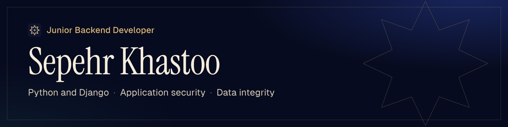

Junior backend developer working in Python and Django, with a focus on application security and data integrity. Computer engineering student in Tehran, open to junior backend roles and internships, remote or on-site.

[Portfolio](https://sepehrkhasto.github.io) · [فارسی](https://sepehrkhasto.github.io/fa/) · [Resume (PDF)](https://sepehrkhasto.github.io/resume/Sepehr_Khastoo_Resume_EN.pdf) · [LinkedIn](https://linkedin.com/in/sepehrkhasto) · [Email](mailto:sepehrkhasto.private@gmail.com)

## Projects

**[Aegis Planner, web](https://github.com/sepehrkhasto/aegis-zk-planner)** · Django, Web Crypto API · v7.1.0  
A zero-knowledge planner: the server only ever stores ciphertext. In the browser, PBKDF2-SHA256 with 600,000 iterations turns the master password into a key that wraps a random data key, and the data key encrypts the vault with AES-256-GCM. Saves carry a revision number, so a stale write from a second device gets HTTP 409 instead of overwriting newer data. Strict CSP, Argon2, rate limiting and lockout. 146 Django tests and 556 JavaScript checks run in GitHub Actions.

**[Aegis Planner, desktop](https://github.com/sepehrkhasto/aegis-planner)** · Python, PyQt6 · v2.11.10  
An offline, encrypted planner for Windows, in Persian with a Jalali calendar. Crash-safe atomic writes, encrypted backups with verify and restore, and installers built from tagged source with published SHA-256 checksums. 971 pytest tests.

**[Refinery Risk Monitor](https://github.com/sepehrkhasto/refinery-risk-monitor)** · FastAPI, SQLAlchemy, WebSocket · team of four  
Live risk scoring, P10/P50/P90 forecasts and anomaly detection for refinery process units. I led the project and set the architecture and the ML pipeline design; I directed the backend, which I built with AI coding tools and reviewed: JWT role-based access per endpoint, and a service that refuses to start in production with a default key or open CORS. Placed in the top three of the course.

**[Andarun](https://github.com/sepehrkhasto/andarun)** · Django · in development  
A text-only, invite-only social network designed to run on a domestic network when international internet access is cut, so it has no email and no outside services. So far: a custom user model with username login, strict usernames, and settings that fail closed. Next: invite-only sign-up, approved by the member who sent the invitation.

## Currently

Building Andarun v1, starting with accounts and invitations, and learning Django REST Framework.

## Stack

**Core:** Python, SQL, Django, PostgreSQL, MySQL, SQLite, Git and GitHub  
**Working knowledge:** class-based views, authentication and permissions, ORM query optimization, transactions and row-level locking, testing with Django TestCase, Docker, Linux, networking fundamentals  
**Also used:** FastAPI, SQLAlchemy, Alembic, WebSocket, Web Crypto API, PyQt6, GitHub Actions  
**Learning:** Django REST Framework  
**Languages:** Persian (native), English (B1)
